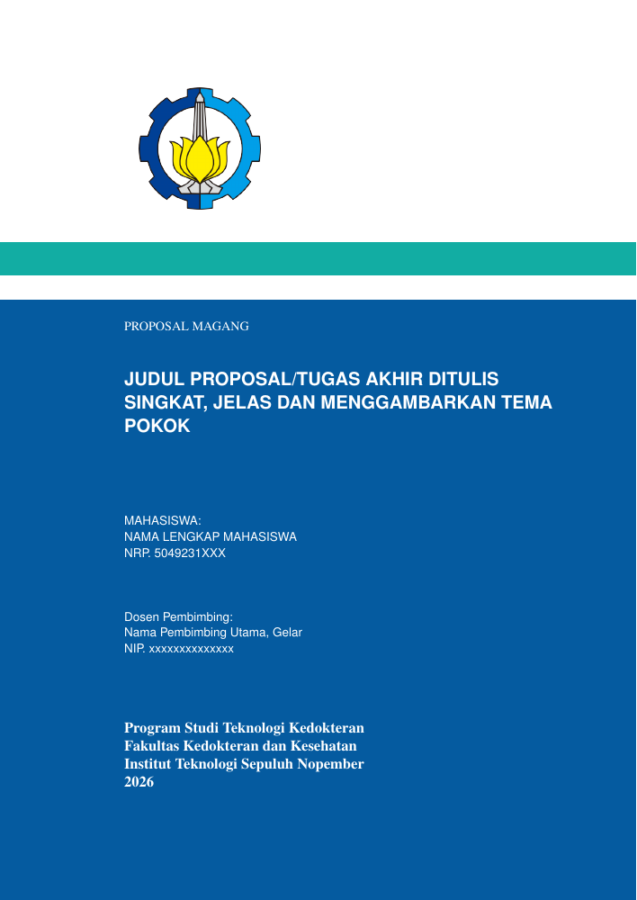

# Template magang Teknologi Kedokteran ITS

Template LaTeX untuk proposal dan laporan akhir magang, disertai [skill AI](skills/magang-tekdok/SKILL.md) yang membantu membuat proyek, mengisi naskah, dan memeriksa PDF. Berkas sumber ada di [`skills/magang-tekdok/template/`](skills/magang-tekdok/template/). Dokumen ini contoh kerja; sesuaikan dengan pedoman prodi dan arahan pembimbing sebelum dikumpulkan.

## Pratinjau



Pratinjau sampul `proposal_magang.tex` memakai judul dan identitas contoh; isi PDF pengguna mengikuti data proyek masing-masing.

## Instalasi

Pasang skill melalui [CLI skills](https://github.com/vercel-labs/skills). Perintah berikut memasang skill secara global agar tersedia dari folder kerja mana pun:

```bash
bunx skills add nashirabbash/skills-magang --skill magang-tekdok -g
```

Tanpa `-g`, skill hanya dipasang untuk proyek saat ini. Instalasi belum menyalin template ke folder kerja; agen meminta izin sebelum membuat proyek. Untuk menghasilkan PDF, komputer perlu distribusi TeX yang menyediakan `latexmk`, `pdflatex`, `biber`, `biblatex-apa`, dan `txfonts`.

## Contoh pemakaian

Buka folder kerja kosong di agen yang mendukung pemanggilan skill dengan garis miring, lalu ketik:

> /magang-tekdok Buat proyek magang di folder ini.

Agen menunjukkan lokasi tujuan dan meminta izin sebelum menyalin template. Jika folder kerja berisi berkas lain, gunakan subfolder kosong agar tidak ada berkas tertimpa. Setelah proyek dibuat:

> /magang-tekdok Bantu isi Bab 1 proposal berdasarkan data dan sumber yang saya berikan.

> /magang-tekdok Periksa PDF laporan magang saya.

Setelah penulisan, agen membangun PDF dokumen target dan melaporkan hasil serta lokasinya. Jika sumber bersama berubah, agen membangun kedua dokumen. Tinjau fakta, sitasi, dan ketentuan prodi sebelum menyerahkan naskah.

## Isi template

- `proposal_magang.tex`: proposal; `laporan_magang.tex`: laporan akhir.
- `pustaka/variables.tex`: nama, NRP, judul, pembimbing, instansi, dan periode magang. Ganti nilai contoh sebelum digunakan.
- `bab/`: naskah; proposal dan laporan memakai bab yang berbeda. Baca pemanggilan `\input` pada berkas utama sebelum menyunting.
- `pustaka/pustaka.bib`: sumber referensi. Kedua dokumen menampilkan satu **contoh daftar pustaka APA** melalui `\nocite{rajpurkar2022ai}` di berkas utama; hapus perintah itu setelah memasukkan sitasi sendiri.
- `lainnya/lampiran-cv.tex`: isi CV proposal sekaligus biodata penulis laporan.

## Bangun PDF secara manual

Dari folder proyek hasil salinan template, jalankan:

```bash
latexmk -pdf -halt-on-error proposal_magang.tex
latexmk -pdf -halt-on-error laporan_magang.tex
```

Hasilnya `proposal_magang.pdf` dan `laporan_magang.pdf` di folder proyek. Jika ingin memakai template tanpa agen, salin isi [`template/`](skills/magang-tekdok/template/) ke folder kosong. Di Overleaf, unggah isinya dan pilih berkas utama sesuai dokumen. Bangun ulang dokumen setelah mengubah isinya; perubahan sumber bersama seperti `pustaka/variables.tex` memerlukan build keduanya. Periksa halaman PDF dan daftar isi setelah perubahan tata letak.

## Contributors

- [@Aisarsyb](https://github.com/Aisarsyb)
